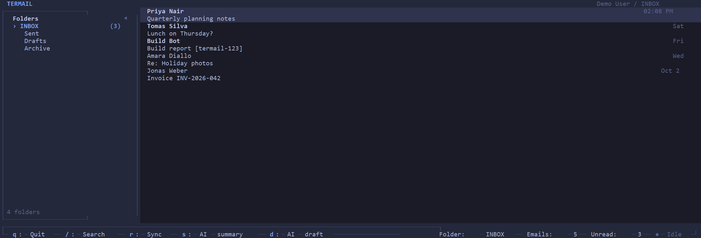

# Termail

A terminal email client built with Bun, TypeScript, and OpenTUI.

Termail syncs mail over IMAP, stores messages locally in SQLite, sends mail
over SMTP, and provides keyboard-first navigation and FTS5 search.

## Features

- IMAP sync (imapflow) with local SQLite persistence and per-folder checkpoints
- Fresh-account bootstrap: folder discovery, INBOX preferred, then message sync
- Full-text search (FTS5) with structured operators (`from:`, `subject:`, `is:`, dates)
- SMTP sending over implicit TLS / STARTTLS (password auth, no external SMTP library)
- Keyboard-first TUI (`j/k` mail, `h/l` folders, `/` search, `r` sync, `q` quit)
- Full-screen composer (`c`): To/Cc/Bcc/Subject/body with native editing,
  Tab/Enter field navigation, and `Ctrl+Enter` send
- Optional AI summarization and reply drafting via OpenRouter (off by default, never auto-sends)
- JSON config with Zod validation; strict TypeScript; Biome lint/format

## Limitations

- External-editor composition is not available.
- `bun run build` succeeds locally on Windows and in Ubuntu CI. If a build
  fails in another environment, `bun run dev`, `bun run test:sequential`,
  and `bun run typecheck` remain the canonical checks.

## Quick Start

### Install globally

Requires [Bun](https://bun.sh/) v1.4.1 or later.

```powershell
bun add --global @arjunmaybe/termail
termail
```

Once installed, run `termail` from any terminal directory.

Each user must configure their own email account and credentials.

### Prerequisites

- [Bun](https://bun.sh/) v1.4.1 (see `packageManager` in `package.json`; CI pins the same version)

### Install

```bash
# Clone and install
git clone https://github.com/arjunmaybe/Termail.git
cd Termail
bun install

# Development
bun run dev

# Production bundle (also exercised by CI)
bun run build

# Run tests (deterministic Bun gate: sequential workers avoid
# pre-existing TUI renderer / global-state contention)
bun run test:sequential

# Vitest runner for the Node-compatible subset only
# (uses vitest.config.ts + src/test/setup.ts).
# The DB-backed suite requires Bun's `bun:sqlite`, so Vitest under
# Node cannot load it; it does not execute the complete suite.
# Bun remains the canonical runner.
bun run test:vitest

# Type check
bun run typecheck

# Lint
bun run lint

# Format
bun run format
```

## Project Structure

```text
termail/
├── src/
│   ├── main.ts                 # Entry point
│   ├── app/
│   │   ├── App.ts              # Root renderable
│   │   ├── layout/             # Layout components (Sidebar, ContentPane, StatusBar)
│   │   ├── components/         # UI components (EmailListView, FolderTabs, WelcomeView)
│   │   └── theme.ts            # Color themes
│   ├── core/
│   │   ├── config/             # Configuration system (ConfigStore, defaults, Zod schema)
│   │   ├── database/           # SQLite database layer (Database, migrations, schema)
│   │   ├── state/              # Reactive app state
│   │   ├── types/              # Core TypeScript types
│   │   ├── imap/               # IMAP sync (service, folders, messages, credentials)
│   │   ├── smtp/               # SMTP sending (service, transport, message, config)
│   │   ├── search/             # Search query parser
│   │   ├── ai/                 # AI assistance (service, prompts, transport)
│   │   └── utils/              # Utilities (logger, errors)
│   ├── app/services/           # SyncService, SearchService/Controller, Compose/AiController
│   └── test/                   # Test setup (Bun sqlite, OpenTUI harness)
├── tests/                      # Test files
├── package.json
├── tsconfig.json
├── biome.json
└── README.md
```

## Configuration

Configuration is stored at `~/.config/termail/config.json`:

```json
{
  "version": 1,
  "database": {
    "path": "~/.local/share/termail/db.sqlite"
  },
  "ui": {
    "theme": "dark",
    "paneRatio": 0.3,
    "showStatusBar": true,
    "showFolderIcons": true,
    "compactMode": false
  },
  "accounts": [],
  "ai": {
    "enabled": false,
    "provider": "openrouter",
    "model": "meta-llama/llama-3.3-70b-instruct",
    "endpoint": "https://openrouter.ai/api/v1/chat/completions",
    "maxBodyChars": 8000,
    "requestTimeoutMs": 30000
  }
}
```

Credentials are never stored in config or the mail database. The fastest
option is a one-time save into the operating-system credential store
(Windows Credential Manager), which Termail reads on every launch:

```powershell
# Run once per account (input is hidden, never displayed)
termail --set-password your-account-id
```

Other commands: `--set-oauth-token [account]`, `--delete-password
[account]`, `--delete-oauth-token [account]` (the account id defaults to
the only configured account). OS storage is implemented on Windows only;
everywhere else, and for headless use, set per-account secrets in the
environment (`TERMAIL_<ACCOUNT_ID>_PASSWORD` or
`TERMAIL_<ACCOUNT_ID>_OAUTH_TOKEN`; non-alphanumeric id characters become
`_`), which always takes precedence. SMTP requires `smtpHost` on the
account; `smtpPort`/`smtpMode` default to implicit-tls/465.

## Keyboard Shortcuts

| Key | Action |
|-----|--------|
| `j` / Down | Next email |
| `k` / Up | Previous email |
| `h` / Left | Previous folder |
| `l` / Right, `Tab` | Next folder |
| `Enter` | Open the highlighted email (never advances to the next one) |
| `Esc` | Back to the list, keeping the highlight |
| `q` | Quit |
| `/` | Search (`Esc` cancels, `Enter` submits) |
| `r` | Sync current folder |
| `c` | Compose a new message (full-screen composer) |
| `s` | AI summary |
| `d` | AI draft reply (into compose, never auto-sends) |

In the composer, `Tab` / `Shift+Tab` cycle To → Cc → Bcc → Subject → Body →
Send, `Enter` moves to the next field (in the body it inserts a newline), and
`Ctrl+Enter` sends — or `Enter` / `Space` on the focused Send target. `Esc` /
`Ctrl+C` discards: an empty composer closes immediately, otherwise `y` discards
and `n` / `Esc` keeps editing.

## Security notes

* Email credentials live in environment variables or the Windows
  Credential Manager entry created by the one-time setup flow — never in
  `config.json`, SQLite, logs, or issue reports. Environment variables
  take precedence when both are configured.
* AI features (`s` summarize, `d` draft reply) send the selected email's
  headers and up to `maxBodyChars` body characters (default 8000) to the
  configured OpenRouter endpoint, only when explicitly invoked. Output is
  display text / drafts for review, never auto-sent.
* The local SQLite database is **not encrypted by Termail**. POSIX systems
  get owner-only data directories/files; Windows ignores POSIX mode bits
  and performs no ACL hardening — configure filesystem ACLs externally if
  multiple users share the machine. See `SECURITY.md` for reporting.

## Screenshots



## License

Termail is released under the [MIT License](LICENSE).